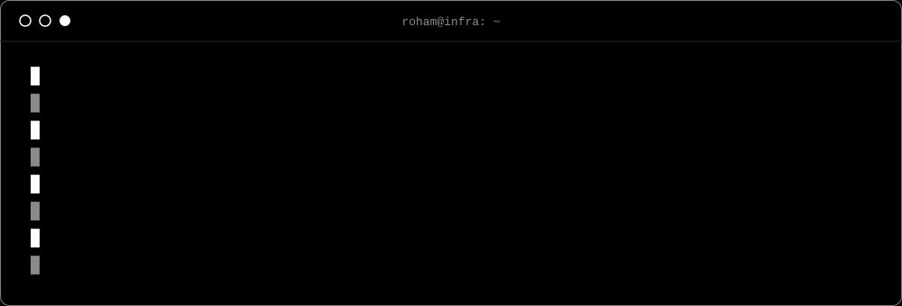
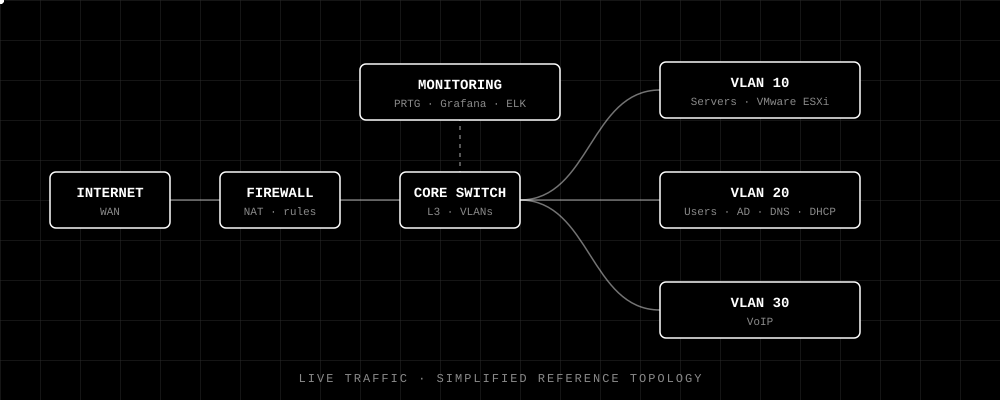

<!-- Replace YOUR_USERNAME, YOUR_LINKEDIN and YOUR_EMAIL below -->

I build, secure and monitor the infrastructure everything else runs on: networks, servers, virtualization and the monitoring around them.
Before this I worked in a NOC where I set up a full monitoring stack, and in software support managing SQL Server data for a large user base.

<b>Full skills breakdown</b>

| Domain | Details |
| :-- | :-- |
| **Network Infrastructure** | VLANs · Inter-VLAN routing · Static & dynamic routing · Switching · Firewalls · MikroTik · Cisco |
| **Network Security** | SSH hardening · Access control · Secure device management |
| **Server & Systems** | Windows Server · Active Directory · DNS · DHCP (lab) · Linux |
| **Virtualization** | VMware ESXi · vCenter |
| **Load Balancing** | HAProxy |
| **Monitoring** | PRTG · ELK · Grafana · PingPlotter · alerting |
| **Data** | Microsoft SQL Server |
| **Telephony** | VoIP configuration |
| **Operations** | Backups · Documentation · Incident response · Tier 1/2 support |

<picture>
  
</picture>

  
  &nbsp;&nbsp;
  

